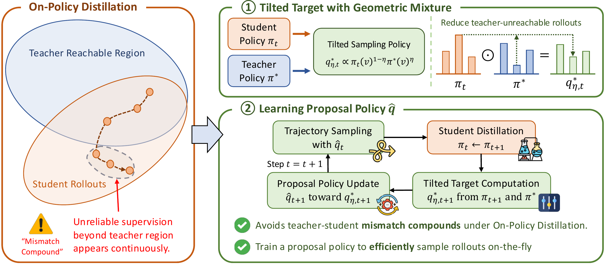

<div align="center">

# Proposing Better Rollouts for On-Policy Distillation

**NeurIPS 2026**

</div>

<p align="center">
  
</p>

> **TL;DR:** MPOPD improves on-policy distillation by sampling rollouts from a learned proposal policy that approximates a geometric mixture of the student and the teacher, instead of from the student alone.

---

## Overview

On-policy distillation (OPD) lets a student model sample its own trajectories and learn from token-level teacher supervision on them, so training matches the student's inference-time behavior. But since rollouts always come from the student, the teacher must also supervise trajectories it would rarely generate itself. On these trajectories its supervision can be noisy or even misleading, which leads to undesirable student patterns such as repetition. Because the updated student defines the next round's rollouts, this **teacher–student mismatch compounds** over training.

To break this loop, we propose **Mixture Proposal On-Policy Distillation (MPOPD)**, which treats the rollout policy itself as an optimization target rather than fixing it to the current student. At each prefix, we shift probability toward tokens the teacher supports more strongly than the student, while staying within a local trust region around the current student so training remains on-policy. The resulting rollout distribution is a **geometric mixture of the student and teacher policies**, with a single scalar $\eta$ interpolating between on-policy and teacher-guided sampling. Sampling from this mixture directly would require running both models at every decoding step, so we train a **proposal policy** to approximate it and generate rollouts in a single forward pass.

---

## Code

> [!NOTE]
> The code is being prepared and will be released in this repository soon.

---

## Citation

If you find this work useful, please cite:

```bibtex
@inproceedings{chen2026proposing,
  title     = {Proposing Better Rollouts for On-Policy Distillation},
  author    = {Chen, Sirui and Qi, Yunzhe and Xu, Haobo and Zou, Jiaru and Ai, Mengting and Li, Zihao and He, Jingrui},
  booktitle = {Advances in Neural Information Processing Systems},
  year      = {2026}
}
```
